# ⚔️ AETHELGARD: THE ASHEN THRESHOLD
## Commercial Game Design Document (Master GDD v3.0)
**Platform Target:** Web (Desktop / Mobile Responsive) · Steam (Chromium/Tauri Wrapper)  
**Engine:** Phaser 3 (Modular ES6 + WebGL / Canvas Fallback) · Custom 2.5D Belt-Scroller Engine  
**Genre:** Stealth Self-Improvement Isekai MMORPG · Dark Fantasy 2.5D Belt-Scroller RPG  
**Author:** Lead Commercial RPG Architect  
**Status:** Approved for Production (Version 3.0 — Pantheon & Cognitive Deflect Standard)  

---

## 📑 TABLE OF CONTENTS
1. [Executive Summary & Vision Statement](#1-executive-summary--vision-statement)
2. [Core Philosophy: Stealth Self-Improvement & Academic Mapping](#2-core-philosophy-stealth-self-improvement--academic-mapping)
3. [The Olympian & Chthonic Pantheon: Religion & Covenant System](#3-the-olympian--chthonic-pantheon-religion--covenant-system)
4. [The 9-Node Continental World Progression](#4-the-9-node-continental-world-progression)
5. [2.5D Side-View Engine & Belt-Scroller Architecture](#5-25d-side-view-engine--belt-scroller-architecture)
6. [Dramatis Personae & Narrative Lore (AI Guild Master Integration)](#6-dramatis-personae--narrative-lore-ai-guild-master-integration)
7. [Combat Mechanics: Real-Time Cognitive Deflect & Hardcore Permadeath](#7-combat-mechanics-real-time-cognitive-deflect--hardcore-permadeath)
8. [Unified Asset Registry & Manifest Architecture](#8-unified-asset-registry--manifest-architecture)
9. [Technical Roadmap & Milestone Delivery](#9-technical-roadmap--milestone-delivery)

---

## 1. EXECUTIVE SUMMARY & VISION STATEMENT

### 1.1 The Concept
*Aethelgard* is a commercial-grade, atmospheric dark-fantasy 2.5D belt-scrolling RPG that operates on a revolutionary dual-layer architecture:
- **Surface Layer:** An unforgiving, gothic dark-fantasy RPG reminiscent of *Dark Souls*, *Blasphemous*, and *Ender Lilies*, featuring crisp pixel art, real-time boss parrying, 4-directional spatial exploration, gear upgrading, and continental conquest.
- **Subterranean Layer (Stealth Self-Improvement):** An uncompromising focus-and-productivity engine. In-game stamina, rare crafting reagents, and continental travel permits are fueled directly by real-world cognitive output: deep-work focus sessions (Chronos Embers), real-world report file submissions, case analysis, quantitative finance models, foreign language translation, and disciplined athletic conditioning.

```
┌────────────────────────────────────────────────────────────────────────┐
│                        AETHELGARD DUAL CORE LOOP                       │
└────────────────────────────────────────────────────────────────────────┘
          Real-World Deep Focus              In-Game Dark Fantasy Mastery
       ┌────────────────────────┐             ┌────────────────────────┐
       │ Business Case Solving  │             │ 2.5D Belt-Scroller RPG │
       │ Pure Math & Logic      │  ────────>  │ Real-Time Deflect Boss │
       │ Finance & Economics    │   Harvest   │ Pantheon Covenants     │
       │ Languages & Athletics  │   Chronos   │ 9-Node Realm Conquest  │
       └────────────────────────┘             └────────────────────────┘
                   ▲                                       │
                   │                                       ▼
                   │         Permanent Mastery / Permadeath│
                   └───────────────────────────────────────┘
```

### 1.2 The Player Persona
The player embodies **The Ashen Wayfarer**—a weary soul from our mundane world who exhausted their vitality in academic, corporate, or intellectual burnout, only to awaken upon the cold cobblestones of **The Ashen Hamlet**. The mysterious borderland of Aethelgard does not grant power through hollow grinding; it demands real-world intellectual mastery, disciplined focus, and covenants with ancient deities.

---

## 2. CORE PHILOSOPHY: STEALTH SELF-IMPROVEMENT & ACADEMIC MAPPING

*Aethelgard* deliberately excludes computer science, programming syntax, and coding puzzles. Instead, the game's core progression strictly maps **5 real-world intellectual and physical domains** to RPG character classes, primary attributes, and divine patronage:

| Real-World Domain | RPG Class Archetype | Patron Deity | Primary Attribute | In-Game Manifestation & Combat Utility |
| :--- | :--- | :--- | :--- | :--- |
| **1. Business Case & Corporate Strategy** | **Grand Tactician** | **Athena** | *Strategic Renown (SR)* | Grants extra countdown time during Boss Deflect cognitive trials & +20% Regional Renown on strategic reports. Critical Riposte damage amplified by +30%. |
| **2. Pure Mathematics & Symbolic Logic** | **Arcane Scholar / Logic Weaver** | **Apollo** | *Geometric Clarity (GC)* | Accelerates SANITY recovery at the Campfire Hearth (+50%) and wards off Void-rot blindness. Geometry barrier shielding and cognitive anomaly dispelling. |
| **3. Quantitative Finance, Economics & Investment** | **High Alchemist / Shadow Broker** | **Hermes** | *Arbitrage Edge (AE)* | Boosts Gold yields (+30%) and Gacha rarity luck (`LUK`) in the Vault of Echoes. Reduced travel stamina exhaustion across the 9 Nodes. |
| **4. Foreign Languages (French & Chinese) & Philology** | **Runic Scholar** | **Hecate & Hermes Trismegistus** | *Linguistic Resonance (LR)* | Unlocks deciphering of Runestones, ancient scrolls (`scroll-a/b/c`), and Hidden Quests. Immunity against psychological charm and sleep hexes. |
| **5. Physical Fitness & Sports (Golf / Athletics)** | **Spellblade / Vanguard** | **Ares & Heracles** | *Vigor & Fortitude (VF)* | Boosts max HP (+25%), ATK (+15%), DEF (+20%), and Posture resilience. Allows chaining dodge dashes without stumbling. |

---

## 3. THE OLYMPIAN & CHTHONIC PANTHEON (RELIGION & COVENANT SYSTEM)

In the lore of Aethelgard, Greek Mythology represents the foundational, primordial religion of the continent. Ancient shrines (`altar.png`), sacred statues (`angel-statue.png`), and grand cathedrals (`cathedral.png`) scattered across the 9 Nodes allow the player to kneel, pray (`[F]`), and swear a **Sacred Covenant** to a Patron Deity. 

A player may maintain one active Patron Covenant at a time, receiving specialized passive blessings, cognitive combat boons, and thematic divine interventions:

```
                          ┌──────────────────────────┐
                          │   THE OLYMPIAN HEAVENS   │
                          │ Athena · Apollo · Hermes │
                          │ Ares · Heracles · Hecate │
                          └─────────────┬────────────┘
                                        │ Covenants & Blessings
                                        ▼
                                ┌───────────────┐
                                │ THE WAYFARER  │
                                │ (The Player)  │
                                └───────┬───────┘
                                        │ Mortality & Time
                                        ▼
                          ┌──────────────────────────┐
                          │    CHTHONIC REALM &      │
                          │   PRIMORDIAL CONSTANTS   │
                          │ Chronos · Hades · Thanatos│
                          └──────────────────────────┘
```

### 3.1 Athena (Goddess of Wisdom & Tactical Warfare)
- **Domain:** Business Case Solving, Strategic Synthesis, and High-Stakes Decision Making.
- **Shrine Resonance:** Found in command tents, war rooms, and guild sanctums.
- **Covenant Blessing — *Pallas's Aegis*:**
  - Grants a **+25% extended countdown timer** during Real-Time Boss Cognitive Deflect challenges, providing crucial breathing room to analyze multi-variable problems.
  - Grants a **+20% bonus Regional Renown** whenever submitting strategic case reports to Guild Masters.

### 3.2 Apollo (God of Light, Truth & Order)
- **Domain:** Pure Mathematics, Symbolic Logic, Deductive Proofs, and Mental Clarity.
- **Shrine Resonance:** Found at sunlit altars and high mountain observatories.
- **Covenant Blessing — *Phœbus's Radiance*:**
  - Empowers the Campfire Hearth (`camp.png`) to restore **SANITY 50% faster** during focus sessions.
  - Grants total immunity to **Void-rot Blindness**, keeping the screen clear of darkness vignettes even when roaming cursed territories.

### 3.3 Hermes (God of Commerce, Wealth & Wayfarers)
- **Domain:** Quantitative Finance, Corporate Valuation, Asset Arbitrage, and Macroeconomics.
- **Shrine Resonance:** Found at crossroads, merchant stalls, and maritime customs houses.
- **Covenant Blessing — *Caduceus Windfall*:**
  - Increases all Gold yields from expeditions, bounties, and merchant sales by **+30%**.
  - Grants high travel fortune across the 9 Nodes, reducing travel exhaustion.
  - Elevates **Gacha Rarity Luck (`LUK`)** in the Vault of Echoes, boosting the drop rate of legendary relics and heirloom blades.

### 3.4 Hecate & Hermes Trismegistus (Keepers of Arcane Tongues)
- **Domain:** Foreign Languages (French, Chinese, Latin), Philology, and Ancient Runes.
- **Shrine Resonance:** Found in overgrown ruins, secluded libraries, and subterranean crypts.
- **Covenant Blessing — *Tongues of the Crossroads*:**
  - Unlocks the ability to decipher ancient Runestones and mysterious vellum scrolls (`scroll-a/b/c`).
  - Unlocks exclusive **Hidden Quests** and secret diplomatic dialogue branches with ancient monarchs and supernatural entities.

### 3.5 Ares & Heracles (Gods of War & Physical Valor)
- **Domain:** Physical Fitness, Athletic Discipline, Sports Conditioning, and Martial Arts.
- **Shrine Resonance:** Found in training arenas, barbarian keeps, and mountain bastions.
- **Covenant Blessing — *Olympian Might*:**
  - Directly increases **Maximum HP (+25%)**, base **ATK (+15%)**, and physical **DEF (+20%)**.
  - Vastly reinforces the player's **Posture Gauge**, reducing posture stagger when blocking heavy blows.

### 3.6 Chronos (Primordial God of Time & Discipline)
- **Domain:** Temporal Continuity, Focus Intervals, and Anti-Procrastination.
- **Shrine Resonance:** Embodied directly within the **Focus Stopwatch at the Central Hearth**.
- **Divine Mechanics:**
  - **The Gift of Chronos (Chronos Embers):** Uninterrupted, verified real-world focus sessions (Pomodoro intervals of 25–90 min) yield glowing *Chronos Embers*, essential for fortifying weapons, crafting permits, and restoring sanity.
  - **Chronos's Curse (Procrastination Penalty):** Abandoning the game or neglecting focused work for days triggers the wrath of Chronos. Passive **SANITY decay** sets in, casting a suffocating black vignette over the screen, slowing movement by 30%, and inflicting severe all-stat debuffs until redeemed by a fresh focus session at the Hearth.

### 3.7 Hades & Thanatos (Lords of the Underworld & Death)
- **Domain:** The Inflexible Boundary of Mortality and Permadeath.
- **Shrine Resonance:** Ancient tombs, crypts, and underworld gates (`portal.png`, `cross-grave.png`).
- **The Law of Thanatos's Toll:** When the player falls in battle (`HP = 0`), Thanatos enforces the unyielding law of mortality (see [Section 7.3](#73-hardcore-permadeath--thanatoss-toll)).

---

## 4. THE 9-NODE CONTINENTAL WORLD PROGRESSION

The continent of Aethelgard spans 9 contiguous territories connected by the historic Imperial Highway. Travel between nodes requires meeting specific **Regional Renown** thresholds and obtaining official guild clearance:

```mermaid
flowchart LR
    Node0["0. The Ashen Hamlet<br/>(0 Renown - Starter)"] --> Node1["1. Oakhaven Outpost<br/>(0 Renown - Frontier)"]
    Node1 --> Node2["2. Bastion of Iron<br/>(100 Renown)"]
    Node2 --> Node3["3. Port Azure<br/>(250 Renown)"]
    Node3 --> Node4["4. Spire of Babel<br/>(500 Renown)"]
    Node4 --> Node5["5. Gilded Nexus<br/>(800 Renown)"]
    Node5 --> Node6["6. Shadowfen Citadel<br/>(1200 Renown)"]
    Node6 --> Node7["7. Sanctum of the Astral<br/>(1800 Renown)"]
    Node7 --> Node8["8. Imperial Capital: Aethelgard<br/>(2500 Renown - Apex)"]

    style Node0 fill:#1f1d24,stroke:#a88c5d,color:#e8d8b8
    style Node1 fill:#252d24,stroke:#66bb6a,color:#e8d8b8
    style Node2 fill:#2b262d,stroke:#90a4ae,color:#e8d8b8
    style Node3 fill:#1c2836,stroke:#4fc3f7,color:#e8d8b8
    style Node4 fill:#2e1f36,stroke:#ba68c8,color:#e8d8b8
    style Node5 fill:#362d1c,stroke:#ffd54f,color:#e8d8b8
    style Node6 fill:#1a2b22,stroke:#81c784,color:#e8d8b8
    style Node7 fill:#1f2238,stroke:#7986cb,color:#e8d8b8
    style Node8 fill:#3a1818,stroke:#e57373,color:#e8d8b8
```



### 4.1 Node Breakdown & Regional Ecology

#### Node 0: The Ashen Hamlet (Starter Sanctuary)
- **Renown Requirement:** 0 Renown (Freely accessible).
- **Environment:** Melancholy borderland ruins cloaked in drifting volcanic ash and creeping ivy.
- **Key Landmarks:** The Central Hearth (`camp.png`), Vault of Echoes, Sanctuary Runestones, Well & Supply Cart, The Ashen Watcher's Arch, and the Unsealed Hamlet Gate to Oakhaven.

#### Node 1: Oakhaven Outpost (Frontier Stronghold)
- **Renown Requirement:** 0 Renown (Directly accessible from Node 0).
- **Environment:** Rugged, misty frontier town surrounded by the dense Gray Thickets.
- **Key Landmarks:** The Adventurers' Guild Cathedral (Seat of Archmage Malakor), The Boar's Tusk Tavern, Merchant Brand's Stall, Central Watchtower & Noticeboard, West Boundary Gate.

#### Node 2: Bastion of Iron (Mountain Fortress)
- **Renown Requirement:** 100 Regional Renown + Oakhaven Guild Permit.
- **Environment:** Monolithic black granite fortress clinging to the frozen Wyrmtooth Peaks.
- **Domain Focus:** Structured Logic, Physical Conditioning, Mechanical Principles.

#### Node 3: Port Azure (Maritime Emporium)
- **Renown Requirement:** 250 Regional Renown + Bastion Permit.
- **Environment:** Cobblestone wharves, deep azure tides, merchant galleons, and sea brine.
- **Domain Focus:** Macroeconomics, International Trade, Asset Valuation Models.

#### Node 4: Spire of Babel (The Monolithic Academy)
- **Renown Requirement:** 500 Regional Renown + Port Azure Permit.
- **Environment:** Obsidian tower piercing storm clouds, housing endless archives of glowing parchment.
- **Domain Focus:** Pure Mathematics, Foreign Languages (French, Chinese), Logic Proofs.

#### Node 5: The Gilded Nexus (Sovereign Banking Metropolis)
- **Renown Requirement:** 800 Regional Renown + Spire Permit.
- **Environment:** Opulent marble boulevards, gilded iron facades, and balance-scale monuments.
- **Domain Focus:** Venture Valuation, Portfolio Theory, Strategic Game Theory.

#### Node 6: Shadowfen Citadel (The Sunken Keep)
- **Renown Requirement:** 1200 Regional Renown + Nexus Permit.
- **Environment:** Treacherous swampland, submerged stone halls, and hallucinogenic bioluminescence.
- **Domain Focus:** Crisis Management, High-Pressure Problem Solving under Severe Time Limits.

#### Node 7: Sanctum of the Astral (The Rift Observatory)
- **Renown Requirement:** 1800 Regional Renown + Shadowfen Permit.
- **Environment:** Levitating monoliths orbiting violet cosmic rifts where space-time twists.
- **Domain Focus:** Metaphysical Deductions, Abstract Epistemology, Advanced Logic.

#### Node 8: The Imperial Capital: Aethelgard (The Throne of Chronos)
- **Renown Requirement:** 2500 Regional Renown + Astral Permit.
- **Environment:** Sovereign golden spires bathed in eternal amber twilight; the nexus of all realms.
- **Domain Focus:** Capstone Problem Synthesis; Apex Real-Time Deflect confrontation with Boss Chronos.

---

## 5. 2.5D SIDE-VIEW ENGINE & BELT-SCROLLER ARCHITECTURE

### 5.1 Belt-Scroller Spatial Coordinate System
*Aethelgard* implements a true **2.5D Belt-Scroller Ground Plane**:
- **Perspective:** Side-view projection with deep vertical walkability across the lower ground plane.
- **Walkable Bounds:** Dynamically derived from viewport height:
  $$\text{Walkable Y} \in [H \times 0.54, \, H \times 0.94]$$
- **Level Dimension:** Standard horizontal span of $W = 2400\text{px}$ per regional zone with smooth camera interpolation (`scrollX` clamping).

### 5.2 Dynamic `sortY` Depth Sorting
To eliminate sprite overlap clipping (such as ground patches rendering on top of the player's feet), each interactable object computes an independent `sortY` depth baseline:
```javascript
// Base campsite depth formula:
campScenery.sortY = campScenery.y - (campScenery.displayHeight * 0.42);
campScenery.setDepth(Math.floor(campScenery.sortY));

// In per-frame update loop:
for (const obj of this.ySortedObjects) {
  obj.setDepth(Math.floor(obj.sortY !== undefined ? obj.sortY : obj.y));
}
```

### 5.3 Solid Footprint Collision Boxes
Objects project 2D footprint bounding boxes at their base. Player foot coordinates $(x, y)$ are checked against obstacle boxes, sliding along unblocked tangent axes for seamless 4-directional traversal.

### 5.4 Universal `[F]` Interaction Standard
- **Keybinding:** `[F]` is the single, universal interaction key across all scenes (with Click/Space fallbacks).
- **HUD Prompts:** Proximity interaction badges project cleanly into screen-space relative to active camera scrolls.

---

## 6. DRAMATIS PERSONAE & NARRATIVE LORE (AI GUILD MASTER INTEGRATION)

### 6.1 Character Matrix
| Character | Location / Role | Demeanor & Voice Style |
| :--- | :--- | :--- |
| **The Ashen Wayfarer** | Protagonist (Player) | Silent, Resolute, Exhausted Intellectual |
| **The Ashen Watcher** | Hamlet Eastern Arch | Archaic, Stoic, Biblical (*Thou*, *Thy*) |
| **Archmage Malakor** | Oakhaven Guild Cathedral | Young, Sarcastic, Hyper-Intellectual AI Evaluator |
| **Merchant Brand** | Oakhaven Frontier Stall | Pragmatic, Shrewd, Mercantile |

### 6.2 The Ashen Watcher
Guardian of the Eastern Gateway in The Ashen Hamlet. When questioned via Branch 3 (*"I am unarmed..."*), he bestows the Starter Gift:
1. `sword-rusted`: A weathered iron blade.
2. `potion-red`: A crimson draught of vital recovery.
3. `scroll-a` (**The Weathered Atlas of Aethelgard**): Unlocks the Continental World Map `[M]`.

### 6.3 Archmage Malakor (AI Guild Master & Report Grading Engine)
Located inside the Oakhaven Adventurers' Guild Cathedral, **Archmage Malakor** serves as the primary gateway to continental advancement:
- **AI-Powered Personality:** Connected to an intelligent LLM API backend. Malakor is young, brilliantly caustic, and possesses zero tolerance for superficial efforts or academic excuses.
- **Real-World Report File Upload:**
  - To fulfill guild contracts and earn regional travel permits, players do not complete mindless fetch quests. Instead, they **upload real-world report files**:
    * Business Case analysis documents (PDF/Markdown)
    * Financial modeling spreadsheets (CSV/XLSX)
    * Formal logical or mathematical proofs
    * Foreign language translations (French / Chinese essays)
- **AI Critique, Roasting & Grading:**
  - Malakor's AI agent parses the submitted file, verifies analytical rigor, logic coherence, and depth, and generates an in-character dark fantasy critique:
    > *"Thou callest this disjointed cash-flow model a strategic defense, Wayfarer? The fen-goblins beneath my tower exhibit sounder risk mitigation! Yet... thy valuation thesis possesses an unexpected spark of competence. Grade: B+. Take these 120 Gold pieces and 40 Renown, and trouble my tea time no further."*
- **Progression Rewards:** Based on the letter grade (A, B, C), Malakor grants EXP, Regional Renown, Gold, and Gacha rolls for legendary relics in the Vault of Echoes.

---

## 7. COMBAT MECHANICS: REAL-TIME COGNITIVE DEFLECT & HARDCORE PERMADEATH

Combat in *Aethelgard* fuses high-stakes rhythm parrying (*Sekiro*, *Nine Sols*) with real-time cognitive problem solving:

### 7.1 Real-Time Cognitive Boss "Deflect" Mechanic
Boss encounters in Aethelgard cannot be won by mindless button mashing:
1. **Lethal Attack Windup (Telegraph):** The Boss charges a devastating ultimate technique accompanied by a crimson flash, ominous audio telegraph, and a **Real-Time Problem Prompt with a Countdown Timer (8–15s)** appearing on screen.
2. **Cognitive Trial:** The prompt presents a high-speed logic puzzle, mental arithmetic calculation, or linguistic translation corresponding to the boss's affinity.
3. **Outcomes:**
   - **Perfect Deflect (Counter-Attack):** Answering correctly before the timer expires triggers a flawless deflect. The player takes **0 damage**, deflect sparks erupt across the screen, and the Boss suffers **massive HP and Posture damage (-40%)**, exposing them to an immediate Critical Riposte.
   - **Failed Deflect:** Answering incorrectly or letting the countdown expire results in taking **full lethal damage**, inflicting severe stagger, and risking immediate death.

```
                  Boss Charges Lethal Ultimate Attack
                                   │
                                   ▼
             Real-Time Problem Prompt + Countdown Timer (8-15s)
                       ┌───────────┴───────────┐
                       ▼                       ▼
            CORRECT ANSWER IN TIME     INCORRECT OR TIMEOUT
           ┌───────────────────────┐ ┌───────────────────────┐
           │ • 0 Damage Taken      │ │ • Full Lethal Damage  │
           │ • Deflect Sparks VFX  │ │ • Severe Stagger      │
           │ • Boss Posture -40%   │ │ • Risk Immediate Death│
           │ • Critical Riposte    │ └───────────────────────┘
           └───────────────────────┘
```

### 7.2 Posture & Rationality Gauge
- Both combatants maintain a **Posture Gauge** beneath their Health Bar.
- Successive Deflects fill the enemy's Posture bar to capacity, triggering **Cognitive Fracture**, which allows the player to unleash devastating execution arts.

### 7.3 Hardcore Permadeath & Thanatos's Toll
True to its dark-fantasy ethos, falling in battle (`HP = 0`) triggers the severe judgment of Thanatos:
1. **100% Carried Loot & Gold Loss:** The player forfeits **100% of all currently equipped/carried weapons, armor, potions, and carried Gold**.
2. **Complete Regional Renown Reset:** The player's **current town's Regional RENOWN resets completely to 0** (erasing progress toward the next frontier travel permit and requiring re-proving oneself to the local guild).
3. **Town Banishment:** The player's broken body is dragged back to the nearest unlocked town or sanctuary.
4. **Permanent Safe Stash Inviolability:** Items, gold, and relics deposited within the town **Safe Stash / Vault of Echoes** are permanently protected and can never be stolen or lost.
5. **Soulbound Keystone Items:** *The Weathered Atlas* and historical focus records are soulbound and remain permanently intact.

---

## 8. UNIFIED ASSET REGISTRY & MANIFEST ARCHITECTURE

### 8.1 Master Manifest Schema (`/assets/manifest.json`)
The asset repository merges foundational sprites and the expansive tileset into a unified tree:
- **Pack 1 (Core Sprites):** 14 foundational sprites (`camp.png`, `ruins-stone.png`, `sword-rusted.png`, `potion-red.png`, etc.)
- **Pack 2 (Dark Fantasy RPG Collection):** 236 high-resolution pixel art assets organized into structured directories:
  - `architecture/buildings/` (cathedral, tavern, cottage, tall-house, timber-house, shop-stall, watchtower)
  - `nature/` (trees, plants, rocks)
  - `props/` (altar, angel-statue, brazier-orange, chest-gold, map-table, noticeboard, well, cart)
  - `equipment/` & `items/` (weapons, armor, scrolls, potions, runes)
  - `effects/` (ash, flame, embers)

### 8.2 Programmatic Asset Resolver (`AssetRegistry.js`)
All asset lookups are routed through `resolveAssetPath(assetId)` and the pre-computed `ASSET_MAP`, guaranteeing zero 404 broken textures and full decoupling from disk folder hierarchies.

---

## 9. TECHNICAL ROADMAP & MILESTONE DELIVERY

| Milestone | Scope | Key Deliverables | Status |
| :---: | :--- | :--- | :---: |
| **M1** | **Asset Consolidation** | Unified `manifest.json`, `AssetRegistry.js`, zero 404 errors | **100% PASS** |
| **M2** | **Hamlet Awakening** | Spawn fix, awakening cutscene, narrative toast, starter gift | **100% PASS** |
| **M3** | **2400px Scroller & Mini-Map** | Horizontal world scrolling, camera tracking, real-time mini-map `[N]` | **100% PASS** |
| **M4** | **World Map & Oakhaven** | 9-Node Atlas modal `[M]`, Scene_Oakhaven, Archmage Malakor spawn | **100% PASS** |
| **M5** | **Master GDD v3.0** | Pantheon religion, AI file grading, cognitive deflect, permadeath | **DELIVERED** |
| **M6** | **Pantheon & Shrine System** | Shrine praying `[F]`, Covenant UI, 7 Deities passive blessings | *Next Sprint* |
| **M7** | **AI Malakor File Evaluator** | Report file upload modal, AI critique engine, grading rewards | *Next Sprint* |
| **M8** | **Combat Deflect Alpha** | Real-time timed problem prompts, deflect sparks, posture break | *Next Sprint* |
| **M9** | **Bastion of Iron (Node 2)** | Mountain fortress scene, 100 Renown gatekeeper, logic challenges | *Next Sprint* |

---

*“Tread softly upon these weathered flagstones, Wayfarer. The Olympians watch from the heavens, whilst Thanatos waits patiently beneath the ash.”*
